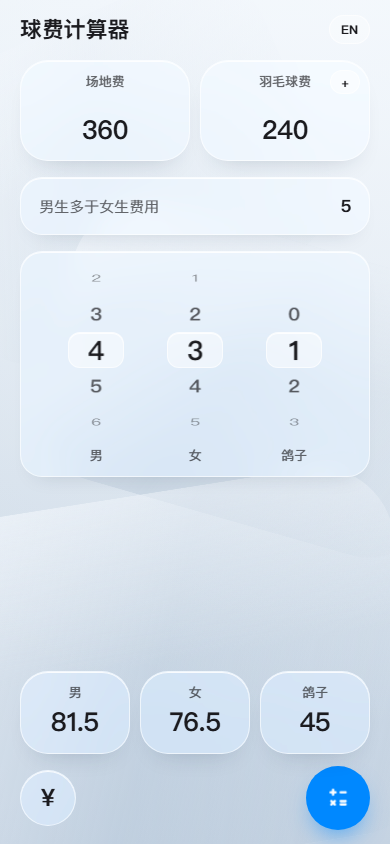

# 球费计算器 · PWA 版

原 Android（Kotlin + Compose）版本的静态网页移植，可直接安装到 iOS 主屏使用。



**零依赖、零构建**：`web/` 目录本身就是产物，推送到任何静态托管即可。

```
web/
├── index.html                 # 页面骨架（含原版的 calculator 图标矢量）
├── manifest.webmanifest       # PWA 清单
├── sw.js                      # Service Worker（离线可用）
├── assets/
│   ├── core.js                # 计算核心（纯函数，对应 FeeCalculate.java + ShuttlecockFee.kt）
│   ├── wheel.js               # 滚轮选择器（原生滚动 + scroll-snap）
│   ├── i18n.js                # 中英文案
│   ├── app.js                 # 状态与交互（对应 CalculatorScreen）
│   └── app.css                # 液态玻璃视觉
├── icons/                     # 图标（由 Android 的 Play Store 图标生成）
├── splash/                    # iOS 启动图（9 种机型 × 浅/深两套）
├── tools/make-icons.mjs       # 从 Android 图标母版重新生成各尺寸图标
├── tools/make-splash.mjs      # 重新生成启动图，并回写 index.html 的 <link>
└── tests/                     # 数值一致性测试
```

## 选型说明

单屏计算器用框架没有收益，反而多出 40 KB 以上的解析/执行开销。这里直接使用
**原生 ES Modules + CSS**：

| 关注点 | 做法 | 收益 |
| --- | --- | --- |
| 首屏 | 静态 HTML，样式内联在 CSS 文件里，无字体下载 | iOS 冷启动无白屏等待 |
| 交互 | 直接操作 DOM，无虚拟 DOM diff | 每次输入只更新几个文本节点 |
| 滚轮 | 原生滚动 + `scroll-snap`，`rAF` 内只改可见项的 transform | 惯性由系统接管，60fps |
| 玻璃质感 | `backdrop-filter` 只用在少数大面上 | GPU 合成，避免整页叠加掉帧 |
| 部署 | 纯静态文件 | GitHub Pages / Cloudflare Pages 免构建 |

字体使用系统字体栈（iOS 上即 SF Pro / 苹方），不加载 Web 字体。

## 本地预览

Service Worker 需要安全上下文（`localhost` 或 HTTPS），别直接双击 `index.html`：

```bash
cd web
python -m http.server 8123
# 或：npx serve .
```

打开 http://127.0.0.1:8123/

调试主题：`?theme=dark` / `?theme=light` 可强制配色（默认跟随系统）。

## 测试

```bash
node --test web/tests
```

`tests/fixtures/jvm-parity.json` 是用**真实的 Android 源码**在 JVM 上跑出来的基准：
413 组随机 + 边界输入，要求 Web 端 `double` 结果与 JVM **逐位相等**，不是近似相等。

重新生成基准（需要 JDK）：

```bash
javac -d /tmp/parity \
  app/src/main/java/com/supremesir/badmintonfeecalculator/FeeCalculate.java \
  web/tests/jvm/ParityFixture.java
java -cp /tmp/parity com.supremesir.badmintonfeecalculator.ParityFixture \
  > web/tests/fixtures/jvm-parity.json
```

## 部署

### GitHub Pages

仓库已包含 `.github/workflows/deploy-pages.yml`：推送到 `master` 且改动 `web/**` 时，
自动把 `web/` 发布到 Pages。

首次使用需在 **Settings → Pages → Source** 选择 **GitHub Actions**。
默认地址形如 `https://<user>.github.io/<repo>/`（子路径已适配，所有资源用相对路径）。

若默认分支不是 `master`，改一下 workflow 里的 `branches`。

### Cloudflare Pages

- Framework preset：`None`
- Build command：留空
- Build output directory：`web`

### 其他静态托管（Netlify / Vercel / 对象存储）

把 `web/` 整个目录作为站点根上传即可，无需任何构建步骤。

## iOS 安装

iOS 没有安装弹窗，需要手动添加：

1. Safari 打开站点
2. 分享按钮 → **添加到主屏幕**

之后从主屏图标启动即为全屏（`display: standalone`），状态栏透明、支持刘海安全区。
首次在 Safari 访问时页面会自动给出这个提示（可关闭，之后不再显示）。

> 注意：必须用 **Safari** 添加。Chrome for iOS 的“添加到主屏幕”只会建一个普通书签。

启动时会先显示 `splash/` 里对应机型、对应配色的启动图（App 图标居中 + 同色底），
然后淡入界面，不会出现一帧白屏/黑屏。没有启动图的机型（比如 iPad、横屏）会退回
iOS 默认的纯色启动帧，功能不受影响。

### 启动图

`index.html` 里那 18 个 `apple-touch-startup-image` 都是 `tools/make-splash.mjs`
生成的，每个机型一对（浅色/深色），`media` 里的 `device-width / device-height /
-webkit-device-pixel-ratio` 必须和图片像素尺寸严格对应，差一点 iOS 就认不出来、
退回纯色启动帧。

```bash
node web/tools/make-splash.mjs   # 重新生成 + 自动回写 index.html 的 link 块
```

启动图里的图标用的是 `icons/icon-maskable-512.webp`（四周留白的版本），
套上圆角卡片后不会把金币边缘切掉。

### 图标

图标不是另画的，直接以 Android 工程的
`app/src/main/new_ic_launcher-playstore.png`（512×512，金币 + 羽毛球那枚）为母版生成，
所以两边完全同款：

| 产物 | 用途 | 说明 |
| --- | --- | --- |
| `icon-180.png` | iOS 主屏 | PNG 兼容性最好，iOS 自己裁 squircle |
| `icon-192.webp` / `icon-512.webp` | manifest | WebP 只有 PNG 的五分之一 |
| `icon-maskable-512.webp` | Android/Chrome | 图案收进 80% 安全区 |
| `favicon.png` | 标签页 | 64×64 |

母版里金币几乎顶到画布边缘，直接塞进 iOS 的 squircle 遮罩会把币缘切掉，
所以生成时统一留了 10% 白边（也更接近 Android adaptive icon 的观感）。

```bash
node web/tools/make-icons.mjs    # 改完 Android 图标后重跑一次
```

改了 `assets/app.css` 里的 `--bg-top / --bg-bottom` 之后记得重跑一次，
脚本里的取色常量要跟着改（在文件顶部的 `THEMES`）。

## 触感反馈

只用了标准 API：

```js
navigator.vibrate(ms);   // 标准振动接口
```

由 `app.js` 里的事件委托统一触发：按钮、结果卡片、费用行按下给 8ms，`=` 计算给
14ms，滚轮每换一格给一次。指针是鼠标时不触发（桌面端不需要）。

**iOS 上不会有任何振动，这是平台限制。** Safari 和主屏应用都没有实现 Vibration
API，也没有别的公开接口能触发 Taptic Engine。之前试过借
`<input type="checkbox" switch>` 的原生开关去"蹭"系统触感，在真机上不生效，
已经删掉——不值得为它保留一段不可靠的黑科技。功能本身不依赖触感。

## 布局高度

`.app` 用 `position: fixed; inset: 0` 铺满 webview，不按任何"算出来的高度"撑开——
浏览器里这样就够，工具栏收起/展开也不会挡住内容。

唯一需要干预的是键盘：`visualViewport.height` 明显小于布局高度时，把骨架收到可视区，
避免底部按钮被顶出屏幕（`syncViewport()`）。

已知限制：部分 iOS 版本从主屏启动时，视口高度比屏幕矮一条（实测 812 vs 874），
那一条只有页面背景色能填，DOM 元素画不进去，看起来像底部多一条带子。这是 iOS
的行为，页面侧没有可用的修补手段；**在 Safari 里正常使用完全不受影响**，
所以不再为它引入任何 hack。

## 与 Android 版的一致性

计算逻辑（含 `Math.ceil(x*10)/10` 的向上取整、`Math.round` 的四舍五入、除以 0 时
产生 `Infinity`/`NaN` 的语义）与 `FeeCalculate.java` 完全一致，由测试锁定。

交互一一对应：场地费/羽毛球费输入、男生加价行（点击就地编辑、失焦回填 5）、
男/女/鸽子三个滚轮（0–20）、计算结果三块（格子可点击复制）、
计算按钮在「输入已改变但未重算」时变红、组合金额面板（6 组常用人数 + 自定义滚轮）、
按桶计算面板（桶价 × 颗数，多行累加，退出时可改回总价）。

有意的差异（都不影响算出来的金额）：

- 金额展示去掉多余的 `.0`：`25.0` 显示为 `25`（原版显示 `25.0`），复制的内容同样是 `25`。
- 无法计算时（例如人数全为 0 导致除零）显示 `—`，原版会显示 `NaN`。
- 新增右上角中/英切换（原版只跟随系统语言），选择会记住。
- 新增按桶计算面板顶部的实时合计（原版合计只回填到背后的输入框，被面板挡住看不见）。
- 去掉了 Compose 特有的透镜折射、色散、惯性高光等效果（浏览器里代价高、收益低），
  改用模糊 + 内高光 + 细描边实现同样的玻璃观感。

## 发布后拿到新版本

SW 的导航请求是 **network-first**：只要发生一次真正的导航，拿到的就是最新 HTML。
从主屏启动时 iOS 可能只是"恢复挂起的页面"而不导航，那就多任务里上滑杀掉、重开一次。

最彻底的办法是设置 → Safari → 高级 → 网站数据 → 搜 `supremesir` → 删除。

## 修改后记得

改动任何静态资源后，把 `sw.js` 里的 `VERSION` 加一（`v1` → `v2`），
否则已安装的用户可能继续用旧缓存。
